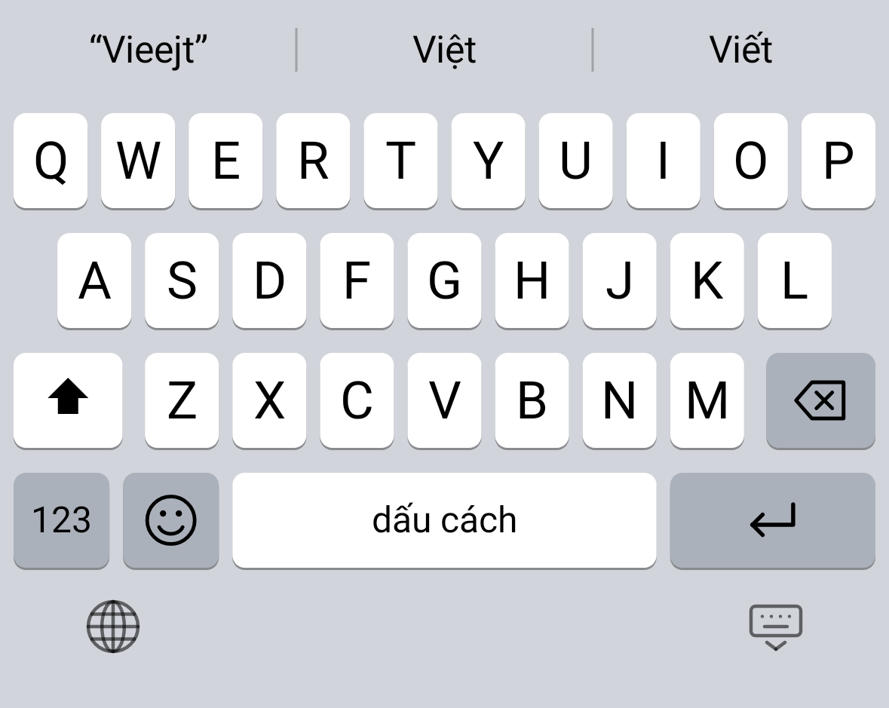
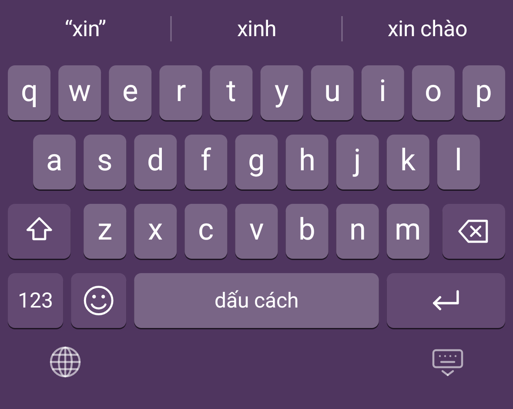
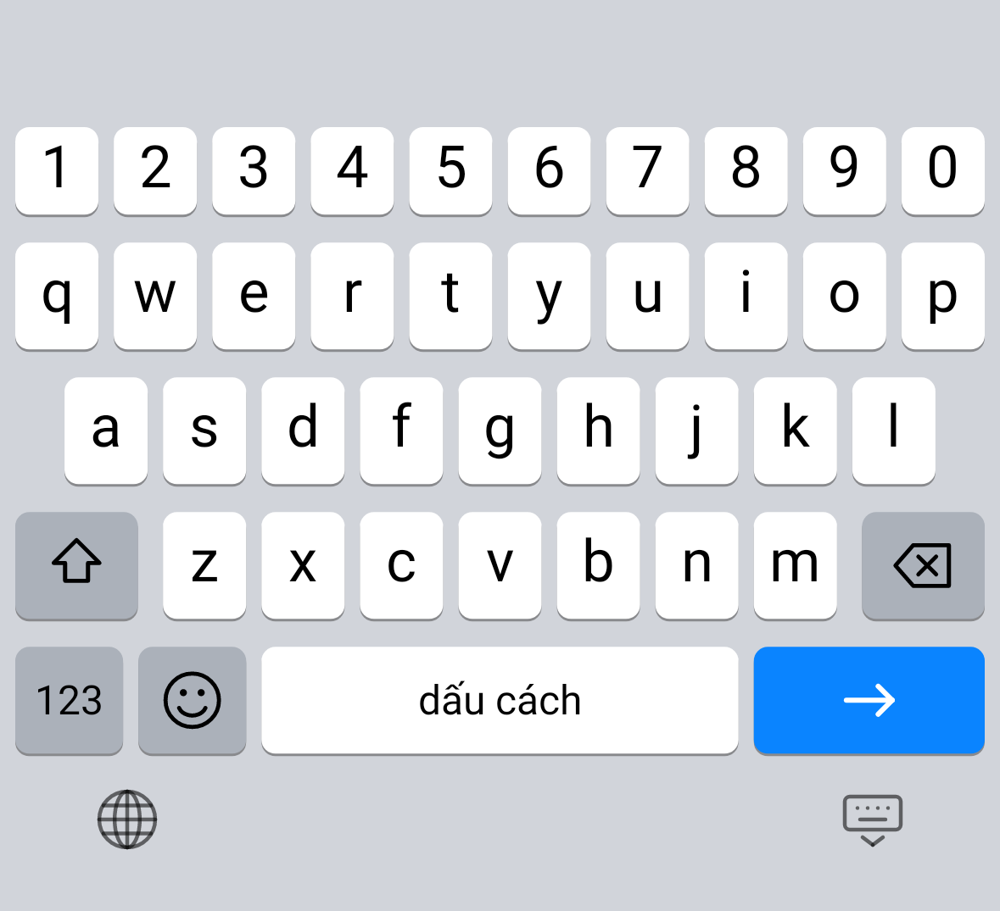
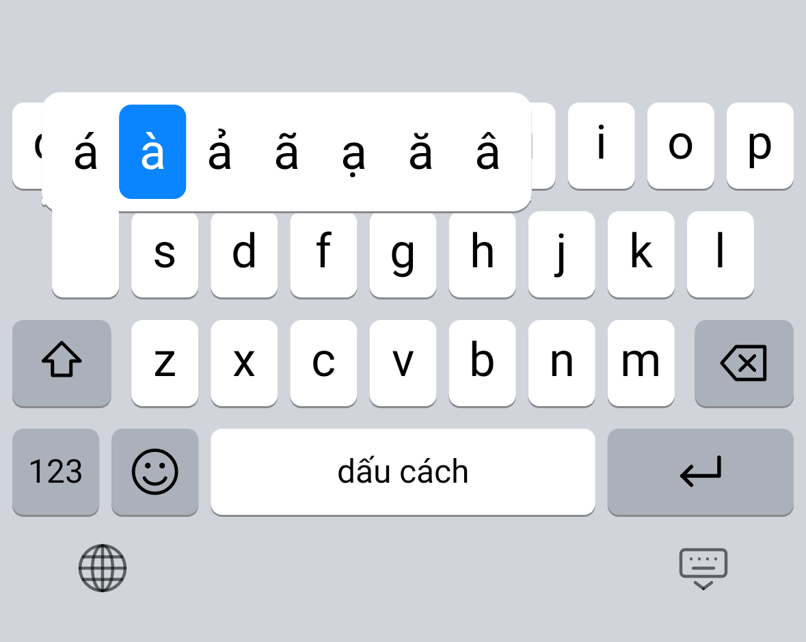
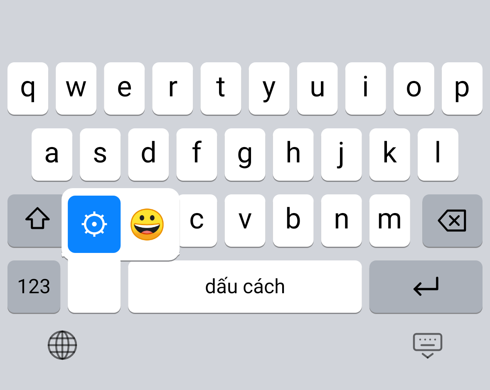
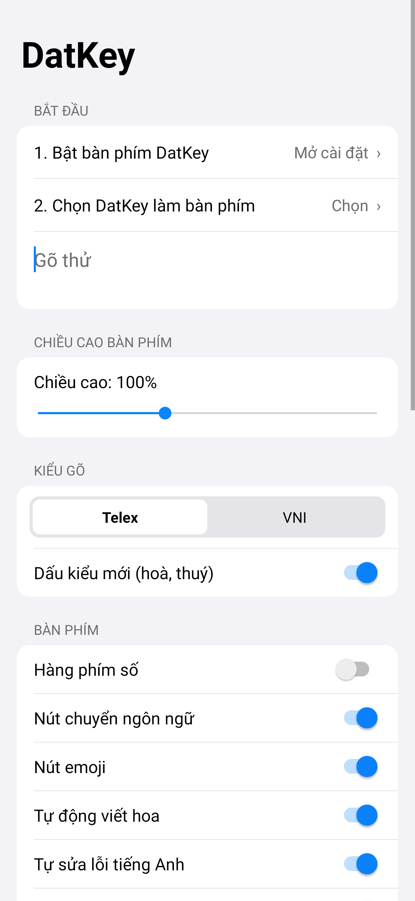

# DatKey

Bàn phím tiếng Việt và tiếng Anh cho Android.

<p>
  
  
</p>
<p>
  
  
</p>
<p>
  
  
</p>

## Tính năng

- Gõ Telex hoặc VNI, chọn đặt dấu kiểu mới (hoà, thuý) hoặc kiểu cũ (hòa, thúy).
- Gõ phím dấu hai lần để bỏ dấu (`ss` → `s`). Chữ tiếng Anh như `text`, `windows` được giữ nguyên.
- Xoá dấu cách để quay lại từ vừa gõ rồi thêm dấu tiếp được.
- Chuyển Việt/Anh bằng nút quả cầu, giữ nút để chọn bàn phím khác.
- Nhấn giữ chữ cái để chọn chữ có dấu, nhấn giữ ký hiệu để chọn ký hiệu phụ.
- Shift, nhấn đúp để bật Caps Lock, tự viết hoa đầu câu.
- Trang số và ký hiệu, tuỳ chọn hiện hàng phím số.
- Emoji theo nhóm. Giữ nút emoji để mở cài đặt bàn phím.
- Gợi ý từ không cần gõ dấu, tự sửa lỗi tiếng Anh, đoán từ tiếp theo theo thói quen.
- Cụm từ thay thế (viết tắt → cụm đầy đủ), nhập/xuất bằng file Excel.
- Kéo phím cách sang trái/phải để di chuyển con trỏ.
- Âm thanh phím, rung, giao diện sáng/tối, 8 màu bàn phím, chỉnh chiều cao.
- Ẩn/hiện nút chuyển ngôn ngữ, nút emoji và thanh gợi ý.

## Cài đặt

1. Cài file APK và mở app DatKey.
2. Bấm "Bật bàn phím DatKey" và bật DatKey trong cài đặt của máy.
3. Bấm "Chọn DatKey làm bàn phím".

## Nhập/xuất cụm từ thay thế

Trong mục "Thay thế văn bản", chọn "Xuất ra file Excel" để lưu danh sách, hoặc "Nhập từ file Excel" để thêm từ file có sẵn. File gồm 2 cột: cột A là viết tắt, cột B là cụm từ, dòng đầu là tiêu đề.

## Build

```
./gradlew assembleRelease
./gradlew testDebugUnitTest
```

Cần Android SDK 35 (khai báo `sdk.dir` trong `local.properties`).

Để ký bản release, tạo file `keystore.properties` ở thư mục gốc gồm `storeFile`, `storePassword`, `keyAlias`, `keyPassword`. File này không được đưa lên git. Không có file thì APK được ký bằng khoá debug.

## Giấy phép dữ liệu

Từ điển gợi ý lấy từ [wordfreq](https://github.com/rspeer/wordfreq) (CC BY-SA 4.0).
